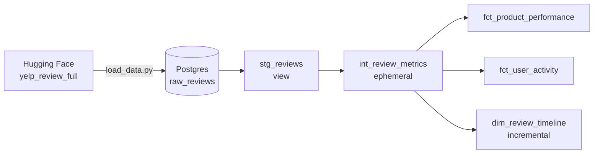
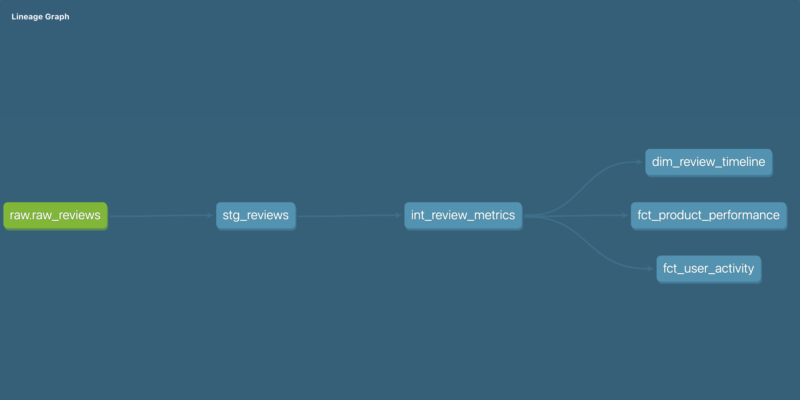

# Yelp Reviews Analytics

An analytics engineering project in dbt and PostgreSQL. Python loads Yelp reviews from Hugging Face, and dbt models them in three layers (staging, intermediate and marts) into business, reviewer and daily-trend tables, with tests and documented lineage.

**Stack:** Python · PostgreSQL · dbt · Hugging Face Datasets

> Part of my portfolio at **[devanshi4.github.io](https://devanshi4.github.io)**

## Highlights

- **Three dbt layers with one source of truth:** "positive review" is defined once, and every mart uses that definition.
- **A score anyone can check:** the 0–100 product health score is a published formula, not a black box.
- **Built to grow:** an incremental timeline model, plus tests on the fact tables' keys.

---

## The problem

Raw review data is one long table of text and star ratings. People who use it ask different questions: which businesses are doing well, which reviewers can be trusted, and how sentiment changes over time. Each answer needs its own table, built from the same cleaned data, so the numbers agree.

## How it works





1. **Load.** `load_data.py` reads 2,000 Yelp reviews and writes them to Postgres as `raw_reviews`.
2. **Staging.** `stg_reviews` renames and types columns, converts timestamps, and labels sentiment and review length.
3. **Intermediate.** `int_review_metrics` adds per-review flags (positive, negative, verified, has helpful votes) once, so every mart uses the same definitions.
4. **Marts.** Three tables answer the business, reviewer and trend questions.

## Design decisions

- **Three layers with clear jobs.** Staging cleans, intermediate defines shared logic, marts answer questions. A change to "what counts as a positive review" happens in one place.
- **Materialization matched to use.** Staging is a view so it's always current. Intermediate is ephemeral (compiled into the marts) because nothing queries it directly. Marts are tables for fast reads.
- **Incremental timeline.** `dim_review_timeline` only processes days newer than what it already holds.
- **Simple, explainable scores.** The product health score is 40% rating, 30% positive share, 20% verified share and 10% helpful share, on a 0–100 scale. Anyone reading the dashboard can see how a business got its score.
- **Honest about the data.** The public Yelp dataset has only a star rating and the review text. Business IDs, user IDs, dates, verification and helpful votes are simulated in the loader with a fixed seed, so the models have realistic many-reviews-per-business data to work with.

## Data model

| Model | Grain | What it answers |
|---|---|---|
| `fct_product_performance` | one row per business | Review volume, rating, sentiment mix, verification rate, health score |
| `fct_user_activity` | one row per reviewer | Reviewing habits, user type, reviewer quality score |
| `dim_review_timeline` | one row per business per day | Daily review counts, average rating, sentiment and engagement |

Tests check that IDs are not null and unique in the marts, and that ratings and sentiment only take expected values.

## Run it locally

You need Python 3.9+ and a local PostgreSQL database called `dbt_analytics`.

1. Install dependencies:

   ```bash
   pip install dbt-postgres datasets pandas sqlalchemy psycopg2-binary
   ```

2. Set `DB_USER` and `DB_PASSWORD` (plus `DB_HOST`, `DB_PORT`, `DB_NAME` if they differ from the defaults), then load the data:

   ```bash
   python data_ingestion/load_data.py
   ```

3. Add an `analytics_project` profile to `~/.dbt/profiles.yml` pointing at the same database, then build and test the models:

   ```bash
   cd dbt_project/analytics_project && dbt run && dbt test
   ```

4. Browse the docs and lineage graph:

   ```bash
   dbt docs generate && dbt docs serve
   ```

## Project structure

```
├── data_ingestion/load_data.py     # Hugging Face -> Postgres raw_reviews
├── dbt_project/analytics_project/
│   ├── models/staging/             # stg_reviews + source and tests
│   ├── models/intermediate/        # int_review_metrics
│   ├── models/marts/               # facts, timeline + tests
│   └── dbt_project.yml
└── Lineage_Graph.png
```

## Status and next steps

- Swap in the full Yelp Open Dataset, which has real business and user IDs, in place of the simulated fields.
- Add `relationships` tests between the marts and staging.
- Run `dbt build` in GitHub Actions on every pull request.
- Put a small dashboard on top of `fct_product_performance`.

---

Built by **Devanshi Pandya** · [Portfolio](https://devanshi4.github.io) · [LinkedIn](https://www.linkedin.com/in/devanshi4/)
